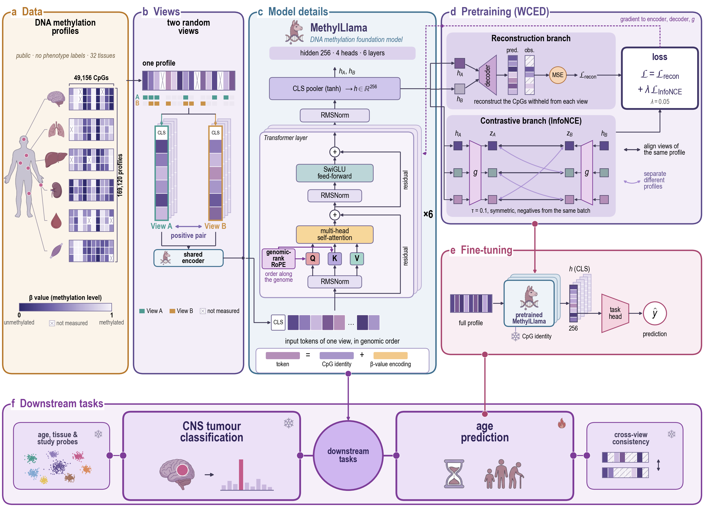

# MethylLlama

**A self-supervised foundation model for human DNA methylation profiles.**

[Model weights (Hugging Face)](https://huggingface.co/netanelazran1/MethylLlama) ·
[Results](results/README.md) · [Tutorials](tutorials/) · License: Apache 2.0

<p align="center">
  
</p>

<sub><b>Overview.</b> (a) 169,120 public DNA methylation profiles at 49,156 CpGs, without phenotype labels.
(b) Two random views of each profile, each keeping 50 % of its measured CpGs. (c) A shared Transformer
encoder with genomic-rank rotary positions pools each view into one 256-dimensional representation.
(d) WCED pretraining: reconstruct the CpGs withheld from each view and align the two views of a profile
(InfoNCE). (e) Fine-tuning a task head on the pretrained encoder. (f) Downstream tasks; the CNS tumour
classification results will be added with the next manuscript update.
[PDF](docs/images/fig1_methylllama_overview.pdf)</sub>

### Key results

| Age prediction, common test set of 2,149 profiles | MedAE (years) | MAE (years) | R² |
|---|---|---|---|
| **MethylLlama** (five-fold ensemble) | **3.112** | **4.333** | **0.9365** |
| ElasticNetCV | 3.437 | 4.731 | 0.9322 |
| MethylGPT (five-fold ensemble) | 3.701 | 5.105 | 0.9110 |

Paired bootstrap of the MedAE gap (10,000 resamples): 0.589 years [0.338, 0.815] against MethylGPT and
0.325 years [0.072, 0.594] against ElasticNetCV. Full tables and intervals: [results/README.md](results/README.md).

MethylLlama is a Transformer encoder for DNA methylation profiles, pretrained without phenotype
labels on 169,120 array profiles and fine-tuned here for chronological-age prediction. It is
pretrained with the **Whole-CpG Encoder–Decoder (WCED)** objective: two random partial views of
each profile are encoded, the sample representation of each view must reconstruct the measured
CpGs withheld from it, and a contrastive term aligns the two views of the same profile.

This repository contains the model code, every script used to produce the results of the
manuscript, and the exact software environment of those runs.

## Model

| | |
|---|---|
| Input | one token per measured CpG: CpG identity embedding + continuous encoding of its β value |
| Encoder | 6-layer pre-norm Transformer, hidden size 256, 4 heads, SwiGLU feed-forward (512), RMSNorm |
| Positions | rotary embeddings (RoPE) on queries and keys, with the CpG's **genomic rank** (chromosome, then coordinate) as position |
| Sample representation | CLS token → linear + tanh (pooler) |
| Vocabulary | 49,156 CpGs + 5 special tokens |
| Parameters | 16.6 M (12.6 M in the CpG embedding table) |
| Pretraining | WCED: two independent 50 % views; reconstruction of withheld CpGs from the CLS representation; symmetric InfoNCE between views (weight 0.05, temperature 0.1) |
| Fine-tuning (age) | head 256 → 128 → 64 → 1, Huber loss, five folds, predictions averaged |

The encoder (`bmfm_methylation/llama/`) is implemented in plain PyTorch. Tokenization uses the
multi-field tokenizer of [BMFM-RNA](https://github.com/BiomedSciAI/biomed-multi-omic), the β encoder
follows its ScaleAdapt encoder, and the WCED objective adapts BMFM-RNA's Whole-cell Expression
Decoder to methylation (see `NOTICE`).

## Repository layout

```
bmfm_methylation/
  llama/        model.py (encoder), scale_adapt.py (β encoder), wced_llama.py (WCED objective),
                pretrain_llama.py, finetune_llama.py (Hydra entry points), configs/
  shared/       data_module.py (dataset, view sampling, genomic ordering), tokenizer.py
scripts/
  data/         genomic rank of the CpG panel, duplicate detection, k-fold splits, pipeline checks,
                data-structure audit (annotations, shared individuals, pretraining exposure, QC)
  pretrain/     pretraining (SLURM)
  finetune/     k-fold fine-tuning, test evaluation, per-sample predictions, random initialisation
  baselines/    ElasticNetCV
  evaluation/   frozen-representation probes and their CIs, leave-one-study-out, withheld-CpG
                reconstruction, cross-view consistency and hard-negative retrieval on the held-out
                partition, paired bootstrap and its sensitivity analyses
  rope_pilot/   genomic-rank versus sequential positions (Supplementary Note 1)
  methylgpt/    MethylGPT comparison: fold data, fine-tuning, test predictions
  figures/      the manuscript figures
configs/        paths.example.sh (copy to paths.sh)
results/        result files of the manuscript (results/README.md)
tutorials/      notebooks and a 500-profile demo dataset; reproduce_paper_results.ipynb
docs/           PROVENANCE.md (names of the original runs)
```

## Installation

The manuscript ran on Linux with Python 3.11.2. To reproduce that environment exactly:

```bash
python3.11 -m venv .venv && source .venv/bin/activate
pip install -r requirements-lock.txt
pip install --no-deps -e .
```

On other platforms, or to use the package with your own versions within the tested ranges:

```bash
pip install -e ".[analysis,wandb,tutorials]"
```

`bmfm-targets` is installed from the BMFM-RNA repository at the commit used for the manuscript
(it is not on PyPI).

## Checkpoints

Pretrained and fine-tuned weights are distributed on Hugging Face
([`netanelazran1/MethylLlama`](https://huggingface.co/netanelazran1/MethylLlama)):

| File | Content |
|---|---|
| `pretrained/methyllama_pretrained_epoch85.ckpt` | WCED-pretrained encoder (epoch 85) |
| `finetuned_age/fold{0..4}.ckpt` | the five age models of the benchmark |
| `tokenizer/cpg_sites/` | the 49,161-entry vocabulary |
| `resources/cpg_genomic_rank*.npy` | genomic-rank position ids for the pretraining and downstream panels |

## Quick start: sample representations

```python
import torch
from bmfm_targets.tokenization import MultiFieldTokenizer
from bmfm_methylation.shared.data_module import MethylationDataset, WCEDCollator
from bmfm_methylation.llama.finetune_llama import load_wced_llama_checkpoint

encoder = load_wced_llama_checkpoint("methyllama_pretrained_epoch85.ckpt").encoder.eval()
tokenizer = MultiFieldTokenizer.from_pretrained("tokenizer")
data = MethylationDataset(h5ad_path="tutorials/data/methylllama_demo_500samples.h5ad",
                          split=None, normalize_age=False)
collate = WCEDCollator(tokenizer=tokenizer, cpg_sites=data.cpg_sites, vocab_size=len(data.cpg_sites),
                       input_ratio=1.0, contrastive=False,
                       genomic_rank_path="resources/cpg_genomic_rank_finetune.npy")

batch = collate([data[0]])
x = torch.stack([batch["cpg_ids"].float(), batch["beta_values"]], dim=1)
with torch.no_grad():
    cls = encoder(input_ids=x, attention_mask=batch["attention_mask"],
                  position_ids=batch["position_ids"]).pooler_output     # (1, 256)
```

The genomic-rank file must match the CpG panel of the input (`cpg_genomic_rank.npy` for the
49,156-CpG pretraining panel, `cpg_genomic_rank_finetune.npy` for the 21,368-CpG downstream
panel). Without `position_ids` the encoder falls back to sequential positions and the
representation is not the one reported. On the first 20 demo profiles these steps reproduce the
manuscript's stored representations (cosine similarity 1.000000, CPU versus the original GPU run).

## Reproducing the manuscript

`tutorials/reproduce_paper_results.ipynb` recomputes the numbers of Table 1, Figs. 2–4,
Supplementary Figs. S1–S4, Supplementary Tables S1–S2, Supplementary Note 1 and the data-structure
counts of the Methods from the result files in `results/`, and compares each with the value printed in
the manuscript; it needs no GPU and no data download (a few minutes on a laptop CPU). The figure
scripts in `scripts/figures/` draw every data figure from the same files (below). To produce the
result files themselves from the public data:

Copy `configs/paths.example.sh` to `configs/paths.sh`, set the data directory and the environment
setup for your system, and run every script from the repository root. The SLURM scripts record the
resources of the original runs in a comment; set a partition if your cluster needs one.

| Step | Script | Output |
|---|---|---|
| Genomic rank of the CpG panel | `scripts/data/sort_probes_genomic.sh`, `scripts/data/create_finetune_genomic_rank.py` | `resources/` (shipped; regenerating overwrites them) |
| Pretraining | `scripts/pretrain/pretrain_methyllama.sh` | `outputs/pretrain-llama-wced/` |
| Duplicates and k-fold splits | `scripts/data/analyze_full_dataset.py`, `scripts/data/create_kfold_splits.py` | `outputs/kfold_splits/` |
| Data-structure audit (Methods, Discussion) | `scripts/data/pretrain_overlap_by_id.py`, then `data_structure_audit.py`; `downstream_integrity_check.py`, `tcga_same_participant_check.py`, `pretrain_heldout_duplicates.py` | `outputs/data_audit/` (copies in `results/data_audit/`) |
| Fine-tuning, five folds | `scripts/finetune/launch_kfold.sh` (→ `finetune_kfold.sh`), `testeval_kfold.sh` | `outputs/finetune-llama-small/` |
| Random-initialisation control | `scripts/finetune/finetune_random_init.sh`, `testeval_random_init.sh` | |
| Per-sample test predictions | `scripts/finetune/run_kfold_test_predictions.sh`, `validate_kfold_test_predictions.py` | `outputs/bootstrap_predictions/` |
| ElasticNetCV | `scripts/baselines/elasticnet_age.sh` | `outputs/baselines/` |
| MethylGPT fine-tuning and test predictions | `scripts/methylgpt/` (see its README) | `outputs/bootstrap_predictions/methylgpt/` |
| Paired bootstrap against MethylGPT | `scripts/evaluation/paired_bootstrap_comparison.py`, `age_restricted_paired_bootstrap.py` | `outputs/bootstrap_predictions/` (copies in `results/age_benchmark/`) |
| Paired bootstrap against ElasticNetCV | `scripts/evaluation/paired_bootstrap_vs_elasticnet.py` | `results/age_benchmark/` |
| Sensitivity of the paired comparison: shared individuals, study clusters, per-study MAE, pretraining exposure | `scripts/evaluation/paired_bootstrap_grouped_sensitivity.py`, `paired_bootstrap_by_exposure.py` | `results/data_audit/` |
| Frozen representations (probes, geometry, UMAP, CpG-embedding locality, 50% subsets) | `scripts/evaluation/run_full_analysis.sh` | `results/pretrained_cls/` |
| Probe CIs, within-tissue study structure | `scripts/evaluation/probe_cis.py`, `within_tissue_study_structure.py` | `results/pretrained_cls/` |
| Leave-one-study-out age probe | `scripts/evaluation/leave_one_dataset_out_probe.py --exclude_study E-GEOD-56105`; sensitivity: `frozen_probe_sensitivity.py` | `results/pretrained_cls/`, `results/data_audit/` |
| Fine-tuned representations | `scripts/evaluation/run_finetune_cls.sh`, `visualize_cls.py --dir results/finetuned_cls` | `results/finetuned_cls/` |
| Withheld-CpG reconstruction, all 16,912 held-out profiles | `scripts/evaluation/run_reconstruction_withheld.sh` (→ `reconstruction_withheld_eval.py`, `reconstruction_paired_bootstrap.py`) | `results/pretrained_cls/reconstruction_withheld/` |
| Cross-view consistency (held-out) | `scripts/evaluation/run_view_consistency_heldout_full.sh`, then `view_consistency_heldout_full.py --merge` | `results/pretrained_cls/view_consistency_heldout_full/` |
| Hard-negative retrieval (held-out) | `scripts/evaluation/hard_negative_heldout.py` (reads the view embeddings of the previous step) | `results/pretrained_cls/hard_negative_heldout/` |
| Genomic-rank pilot | `scripts/rope_pilot/` | `outputs/ablation_rope/` (copies in `results/rope_pilot/`) |
| Figures | see below | `figures/paper/` |

The data figures are drawn from `results/` alone (no GPU, no data); each script writes PDF, PNG and
SVG under the file name used in the manuscript sources, plus a provenance JSON with the plotted values:

| Figure | Script | Output |
|---|---|---|
| Fig. 1 (schematic) | not scripted here | `docs/images/fig1_methylllama_overview.{pdf,png}` |
| Fig. 2 | `scripts/figures/fig2_retrieval_reconstruction.py` | `fig2_retrieval_reconstruction` |
| Fig. 3 | `scripts/figures/fig3_representation.py` | `fig3_representation` |
| Fig. 4 and Supplementary Fig. S4 | `scripts/figures/fig4_age_benchmark.py` | `fig4_age_benchmark`, `figS5_age_benchmark` |
| Supplementary Fig. S1 | `scripts/figures/figS_crossview.py` | `figS2_crossview` |
| Supplementary Fig. S2 | `scripts/figures/figS_panel_independence.py` | `figS_panel_independence` |
| Supplementary Fig. S3 | `scripts/figures/figS_finetuning_effect.py` | `figS_finetuning_effect` |

The MethylGPT comparison fine-tunes the released MethylGPT checkpoint (encoder and age head
trained) with MethylGPT's fine-tuning code on the same samples and folds (`scripts/methylgpt/`);
`scripts/evaluation/paired_bootstrap_comparison.py` refuses to run unless both models predict the
same 2,149 test profiles with identical ages, and `scripts/methylgpt/validate_kfold_predictions.py`
checks the MethylGPT fold files. `scripts/data/compare_splits_21k.py` and `verify_21k_comparison.py`
are the corresponding checks made for an earlier single-split MethylGPT run.

`docs/PROVENANCE.md` maps the script, run and folder names used here to those of the original runs
(SLURM job ids and W&B runs).

## Data

All data come from public repositories (GEO, ArrayExpress and the open-access tier of TCGA).
Apart from the 500-profile demo subset in `tutorials/data/` and the derived result files in
`results/`, they are not redistributed here.

- **Pretraining corpus**: the processed 49,156-CpG matrix assembled for MethylGPT
  (Ying et al., 2024) from the EWAS Data Hub and ClockBase (169,120 profiles in the version used),
  available through the [MethylGPT repository](https://github.com/albert-ying/MethylGPT).
- **Downstream corpus**: the AltumAge collection (de Lima Camillo et al., 2022), 10,988 profiles at
  21,368 CpGs, as organised in the [AltumAge repository](https://github.com/rsinghlab/AltumAge)
  (MIT licence).
- **CpG coordinates**: Illumina HumanMethylation450 manifest, hg38
  ([InfiniumAnnotation](https://zwdzwd.github.io/InfiniumAnnotation); Zhou et al., 2017).
- **Pretraining annotations**: the study, tissue, sex, age and individual (`PATIENT_ID`) annotations that
  accompany the pretraining corpus (`pretrain_metadata.csv.gz`); used only by the data-structure audit
  and the hard-negative analysis.

## Citation

The manuscript is in preparation. Until a preprint is available, please cite this repository:

```bibtex
@software{azran2026methyllama,
  author = {Azran, Netanel and Rosen-Zvi, Michal and Yakir, Benjamin and Danziger, Michael M.},
  title  = {{MethylLlama}: self-supervised foundation modelling of human {DNA} methylation profiles},
  year   = {2026},
  url    = {https://github.com/netanelazran11/MethylLlama}
}
```

Please also cite MethylGPT (Ying et al., 2024, doi:10.1101/2024.10.30.621013) for the pretraining
corpus and AltumAge (de Lima Camillo et al., npj Aging 8, 4, 2022) for the downstream collection.

## Licence

Apache License 2.0. See `LICENSE` and `NOTICE`.
